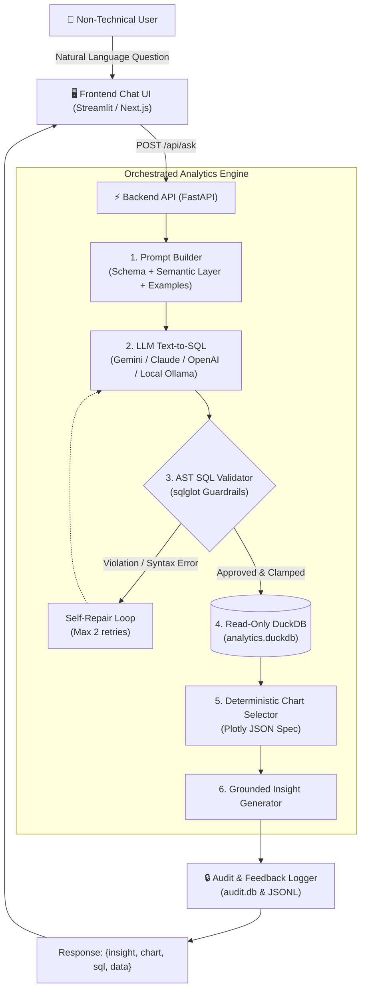

# 📊 Product Analytics Chatbot

> **A natural-language analytics agent:** ask questions about product data in plain English, get validated SQL, interactive charts, and executive insights in seconds.

---

## 1. Architecture Overview



---

## 2. 🛡️ 100% Security & Data Protection Architecture

When handling sensitive business or customer data, security must be **built into the architecture by design**, not added as an afterthought. This project enforces a **Multi-Layer Defense-in-Depth Model**:

| Security Layer | Threat Prevented | Enforcement Mechanism |
| :--- | :--- | :--- |
| **1. Zero Raw Data to LLM** | Data Exfiltration / PII Leakage | The LLM **NEVER** sees customer rows, personal data, or table contents. It only receives the schema definition (column names/types) and metric formulas. Only aggregated summary stats are passed for insight generation. |
| **2. 100% Air-Gapped Option** | Third-Party Cloud Data Egress | Supports **Local Ollama** (e.g. `llama3.2`) running entirely on your machine. Not a single token or byte leaves your infrastructure. |
| **3. AST SQL Guardrail (`sqlglot`)** | SQL Injection & Prompt Injection | Parses the generated SQL into an Abstract Syntax Tree (AST). Strictly allows **only a single `SELECT` statement**. Blocks `DROP`, `DELETE`, `UPDATE`, `INSERT`, `ALTER`, `TRUNCATE`, `CREATE`, `ATTACH`, and `PRAGMA`. |
| **4. Table & Column Whitelist** | Unauthorized Data Access | Restricts queries strictly to authorized tables (`users`, `events`, `orders`, `products`, `sessions`). Any reference to system tables (`sqlite_master`, `duckdb_tables`) is rejected. |
| **5. Filesystem Sandbox** | Arbitrary Code / File Execution | Rejects functions that read/write local disks or cloud storage (`read_csv`, `read_parquet`, `httpfs`, `shell`). |
| **6. Kernel-Level Read-Only Access** | Database Mutation Zero-Days | DuckDB connections are opened with **`read_only=True`**. Even if an attacker bypassed the validator, DuckDB's engine physically rejects writes at the storage layer. |
| **7. Automatic LIMIT & Timeouts** | Denial of Service (DoS) / Memory Exhaustion | Queries are automatically clamped with a mandatory `LIMIT 1000` and protected by execution timeouts. |
| **8. Immutable Audit Logging** | Non-Repudiation & Compliance | Every question, generated query, execution duration, and validation result is logged to `logs/audit.db`. |

---

## 3. Technology Stack

- **Backend Framework**: **FastAPI** (Python 3.11+) - Asynchronous, strict Pydantic schemas, auto OpenAPI docs.
- **Analytical Database**: **DuckDB** - In-process columnar OLAP engine designed for lightning-fast aggregations, window functions, and time-series metrics.
- **SQL Parser & Guardrail**: **sqlglot** - Validates and transpiles SQL queries via AST traversal.
- **LLM Engine**: Multi-provider client (`backend/llm_client.py`):
  - Google Gemini API (`GEMINI_API_KEY`)
  - Anthropic Claude API (`ANTHROPIC_API_KEY`)
  - OpenAI API (`OPENAI_API_KEY`)
  - Local Ollama (`http://localhost:11434` for 100% private on-prem execution)
  - Offline Mock Mode (deterministic patterns for zero-cost testing)
- **Data Visualizations**: **Plotly** - Dynamic, interactive client-side charts generated from deterministic result-shape rules.
- **Chat Frontend**: **Streamlit** - Clean, responsive UI with suggested question chips, loading animations, collapsible SQL inspection, and CSV export.
- **Testing & Evals**: **pytest** & custom evaluation benchmark suite.

---

## 4. Quickstart Guide

### 1. Set Up Environment & Install Dependencies
```bash
# Create virtual environment
python3 -m venv .venv
source .venv/bin/activate

# Install requirements
pip install -r requirements.txt
```

### 2. Configure Environment Variables
```bash
cp .env.example .env
# Edit .env to set your preferred LLM_PROVIDER ("gemini", "anthropic", "openai", "ollama", or "mock")
```

### 3. Generate the Synthetic Dataset
```bash
python data/generate_data.py
```
This generates 15,000+ realistic SaaS/e-commerce users, 100,000+ funnel events, orders, and sessions into `data/analytics.duckdb`.

### 4. Run Unit Tests & Security Suite
```bash
pytest tests/ -v
```

### 5. Run the Evaluation Benchmark
```bash
python evals/run_evals.py
```

### 6. Launch the Application
- **Option A (Interactive Chat UI - Streamlit)**:
  ```bash
  streamlit run frontend/app.py
  ```
- **Option B (FastAPI REST Backend)**:
  ```bash
  uvicorn backend.main:app --reload --port 8000
  ```

---

## 5. Supported Question Types

1. **Trends Over Time**: "Show weekly signups for the last 3 months" $\to$ Line Chart
2. **Top-N Rankings**: "Top 5 countries by signups last month" $\to$ Bar Chart
3. **Funnels & Drop-Off**: "Where do users drop off in checkout?" $\to$ Funnel Bar Chart
4. **Retention / Cohorts**: "Week-1 retention by signup month" $\to$ Cohort Chart
5. **Segment Comparisons**: "Compare mobile vs desktop conversion" $\to$ Grouped Bar / Pie Chart
